# FIXIT — Local Service Booking Platform

[](https://react.dev/)
[](https://vitejs.dev/)
[](https://nodejs.org/)
[](https://expressjs.com/)
[](https://www.mongodb.com/)
[](https://tailwindcss.com/)
[](https://leafletjs.com/)
[](#automated-testing--verification)
[](#automated-testing--verification)

> **A production-grade, full-stack on-demand local services platform connecting customers with nearby verified trade and repair professionals.**

---

## Table of Contents

- [Overview](#overview)
- [System Architecture](#system-architecture)
- [Key Features](#key-features)
- [Core Workflows](#core-workflows)
  - [Booking State Machine](#booking-state-machine)
  - [Service Verification (OTP Flow)](#service-verification-otp-flow)
  - [Simulated Payment Flow](#simulated-payment-flow)
  - [Geospatial Map & Discovery Flow](#geospatial-map--discovery-flow)
- [Security Architecture](#security-architecture)
- [Screenshots Showcase](#screenshots-showcase)
- [Tech Stack](#tech-stack)
- [Automated Testing & Verification](#automated-testing--verification)
- [API Reference](#api-reference)
- [Local Development Setup](#local-development-setup)
- [Docker Deployment](#docker-deployment)
- [Production Deployment Guide](#production-deployment-guide)

---

## Overview

**FIXIT** solves the trust, scheduling, and discovery barriers in hiring trade and home maintenance professionals (Electricians, Plumbers, AC Technicians, Appliance Mechanics, Cleaners, and Computer Repair Specialists). 

Unlike unstructured classifieds, FIXIT enforces an end-to-end digital contract:
1. **Nearby Proximity**: MongoDB `2dsphere` geospatial indexing and Leaflet OpenStreetMap discovery find active providers within custom service radiuses.
2. **Double-Booking Prevention**: Schedule conflict guards prevent overlapping appointments.
3. **In-Person Physical Verification**: Cryptographically hashed 4-digit OTP codes verify on-site arrival before work commences.
4. **Platform Governance**: An 8-module administrative console manages user auditing, provider verification badges, review moderation with dynamic rating recalculation, and service catalog CRUD.

---

## System Architecture

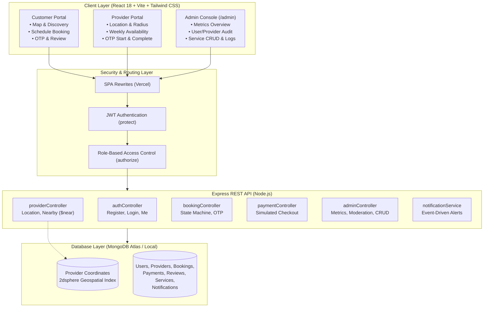

---

## Key Features

### 👤 Customer Experience
* **Service Catalog**: Browse curated home repair and maintenance service categories with transparent base pricing.
* **Geospatial Map Discovery**: View nearby service professionals on an interactive OpenStreetMap view, trigger browser GPS geolocation, and filter by search radius (km).
* **Availability-Based Booking**: View provider weekly operating hours and select open time slots without risk of double-booking.
* **Service OTP Verification**: Receive a secure 4-digit OTP code upon booking confirmation to give to the technician upon arrival.
* **Simulated Checkout**: Test demo payment processing across UPI, Card, and Cash simulation with transaction receipt generation.
* **In-App Notification Hub**: Real-time unread counter and notifications for booking status updates, payments, and reviews.
* **Provider Reviews**: Rate and review completed services (1–5 stars) with verified customer feedback.

### 🔧 Provider Experience
* **Profile & Coverage Management**: Manage business credentials, hourly rates, service area tags, address, and interactive map location with adjustable coverage radius (1–100 km).
* **Weekly Schedule Configuration**: Set distinct operating windows (start time / end time) for each day of the week.
* **Dispatch & Job Lifecycle**: Accept or reject incoming booking requests in real time.
* **Secure OTP Verification**: Verify the customer's 4-digit OTP on-site to transition bookings to `in-progress`.
* **Completion & Earnings**: Mark services as completed, trigger customer payment reminders, and track client reviews.

### 🛡️ Administrator Experience
* **Command Center Overview**: Platform metrics covering total users, provider verification breakdown, booking lifecycle distribution, and total simulated revenue.
* **User Directory**: Search and filter platform users by role (`customer`, `provider`, `admin`) with full profile inspection.
* **Provider Verification**: Review submitted business credentials and toggle official platform verification badges.
* **Bookings Inspection**: Inspect booking details across all lifecycle stages with full party attribution without arbitrary status tampering.
* **Review Moderation**: Audit and delete abusive reviews with **automatic real-time provider rating and review count recalculation**.
* **Service Catalog Management**: Add, update, and safely delete service offerings with built-in guards blocking deletion if active bookings depend on the service.
* **Audit Event Logs**: Comprehensive system event log stream for platform transparency.

---

## Core Workflows

### Booking State Machine

FIXIT enforces a deterministic state machine protecting both customers and providers:

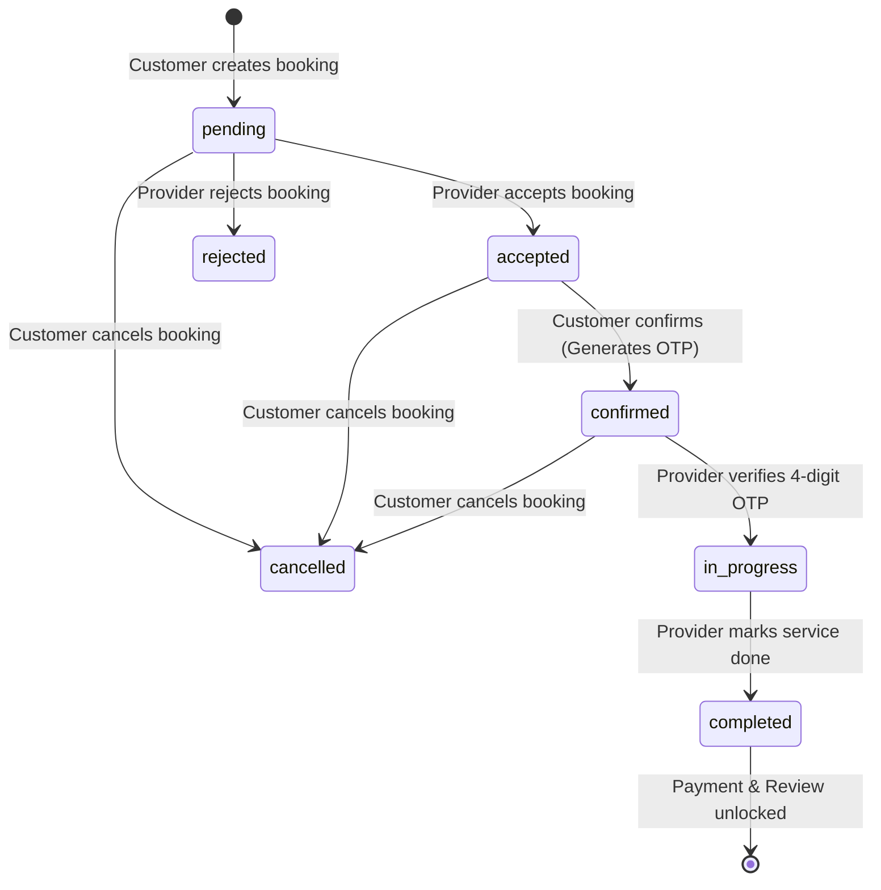

---

### Service Verification (OTP Flow)

To eliminate service disputes, FIXIT utilizes in-person cryptographic verification:

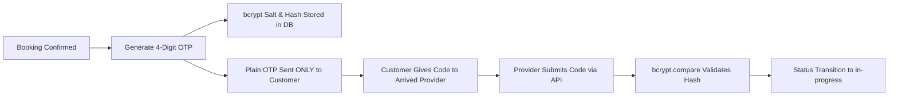

> **Security Note**: The provider API responses strictly mask `otpHash` and raw OTP fields using projection, ensuring the provider cannot know the code prior to physical arrival.

---

### Simulated Payment Flow

> **Implementation Notice**: FIXIT currently uses a simulated/demo payment architecture for safe functional testing and portfolio demonstration without real financial transactions.

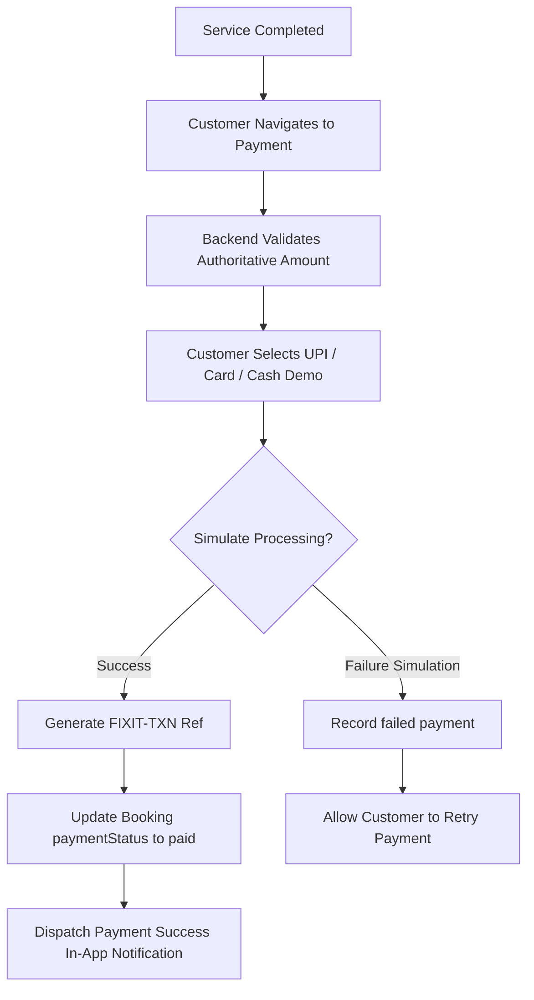

---

### Geospatial Map & Discovery Flow

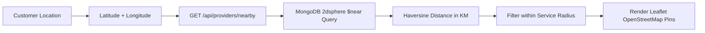

---

## Security Architecture

* **JWT Stateless Authentication**: Secure token verification via HTTP Authorization Bearer headers with automatic expiry handling.
* **Role-Based Access Control (RBAC)**: Strict role guards (`authorize('admin')`, `authorize('provider')`, `authorize('customer')`) prevent cross-role privilege escalation.
* **Resource Ownership Authorization**: Customers and providers can only view and modify their own bookings, notifications, and transactions.
* **One-Way Password & OTP Hashing**: Sensitive credentials are never stored in plaintext; passwords and OTP codes are salted and hashed using `bcryptjs`.
* **Zero Secret Exposure**: Production error handler strips stack traces in production mode (`process.env.NODE_ENV === 'production'`). Sensitive database fields (`password`, `otpHash`) use `{ select: false }` or explicit exclusion projections.
* **CORS Domain Whitelisting**: Strict origin matching ensures only authorized frontend URLs can communicate with the Express API.

---

## Screenshots Showcase

| Home Landing Page | Service Catalog |
| :---: | :---: |
| 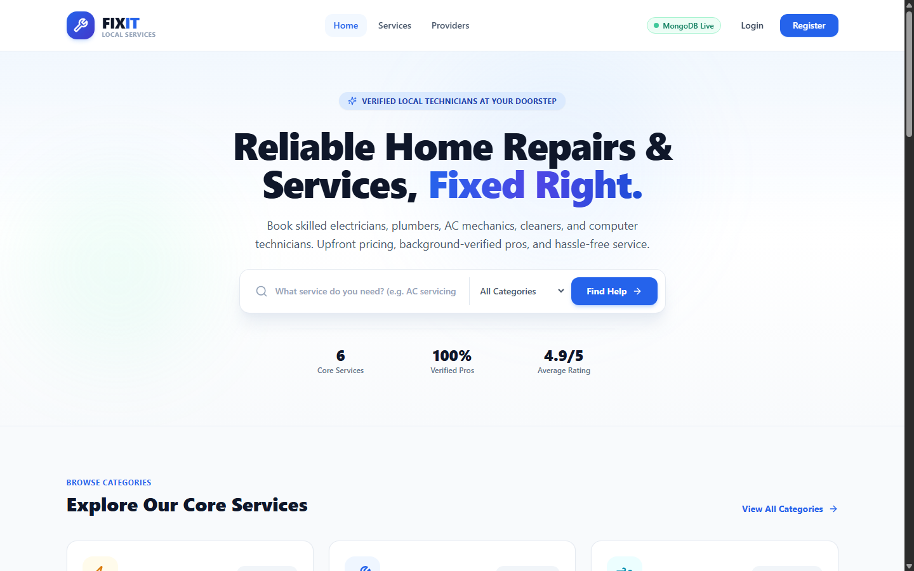 | 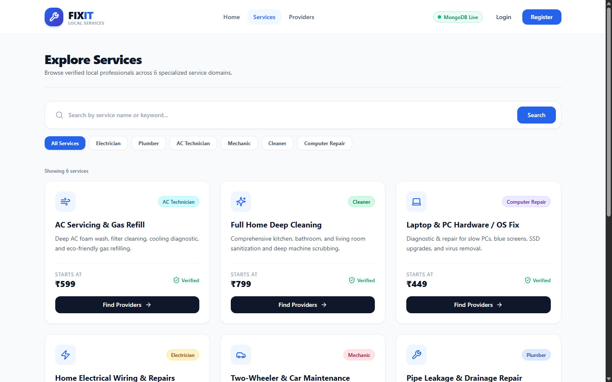 |

| Provider Discovery (List View) | Interactive Map View |
| :---: | :---: |
| 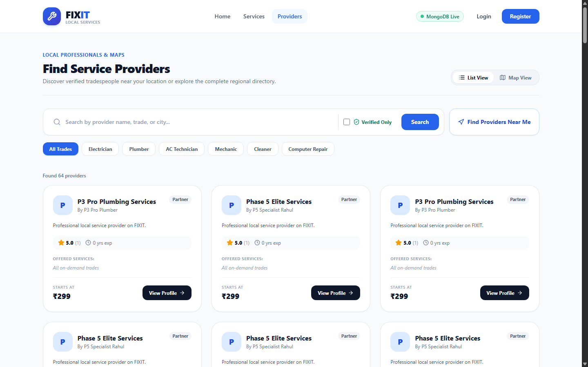 | 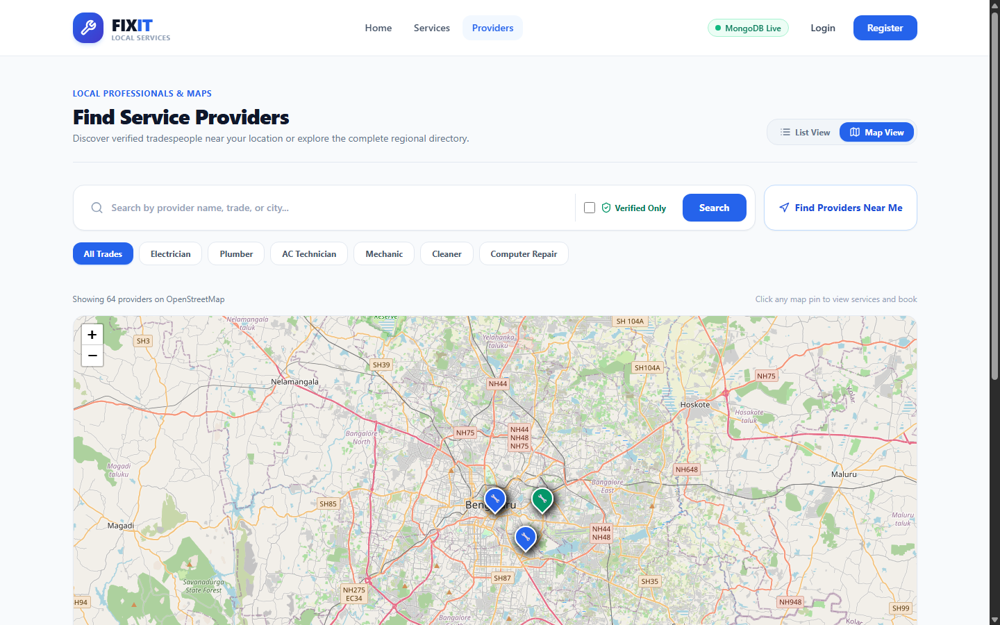 |

| Provider Location & Radius Picker | Provider Dashboard |
| :---: | :---: |
| 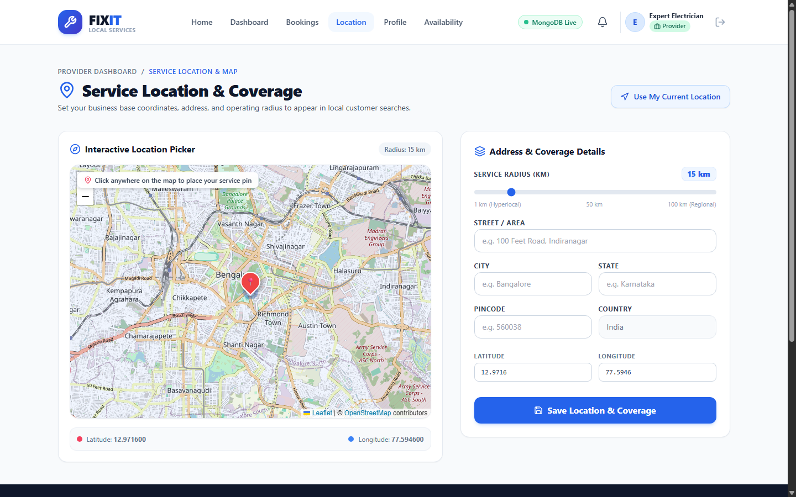 | 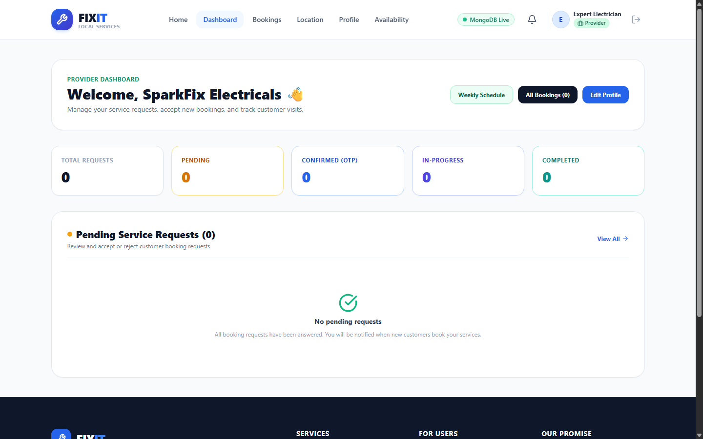 |

| Customer Dashboard | Notification Center |
| :---: | :---: |
| 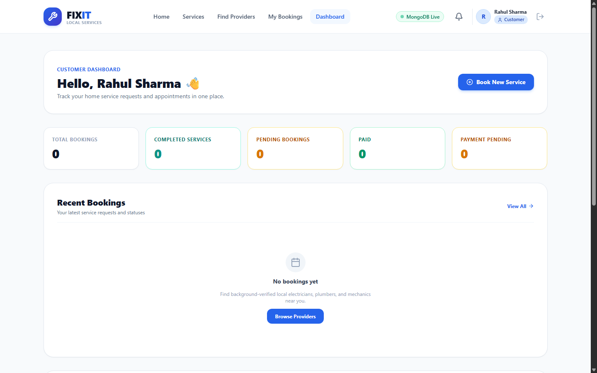 | 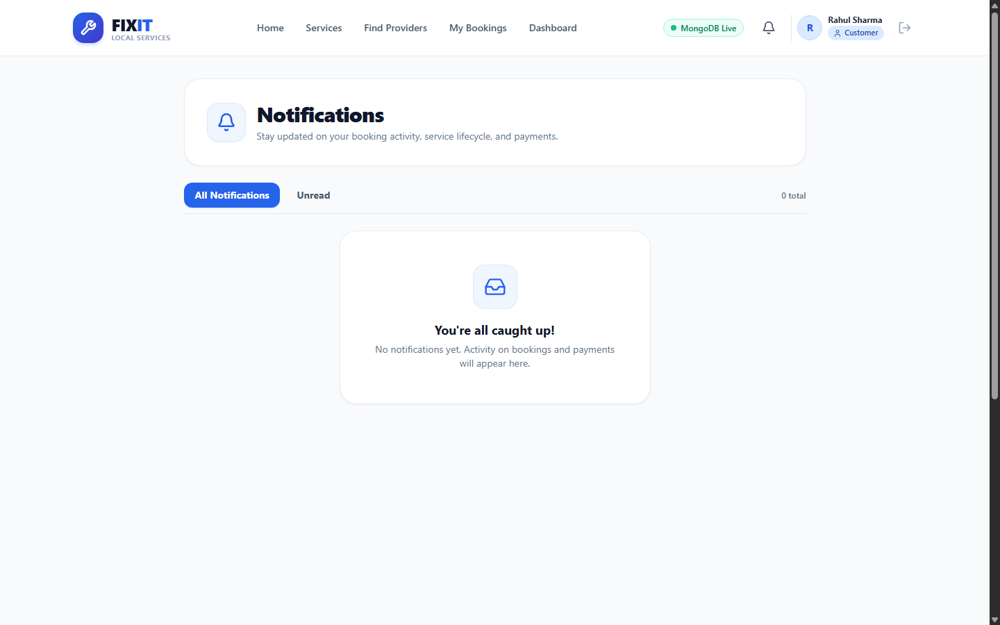 |

| Admin Console — Platform Overview | Admin — Provider Verification |
| :---: | :---: |
| 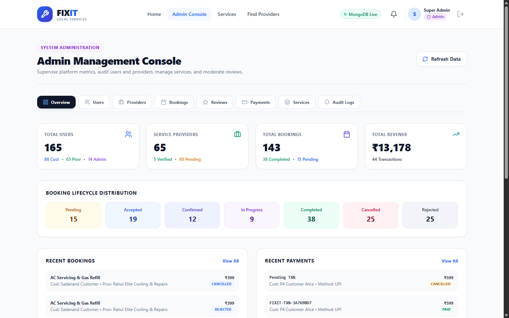 | 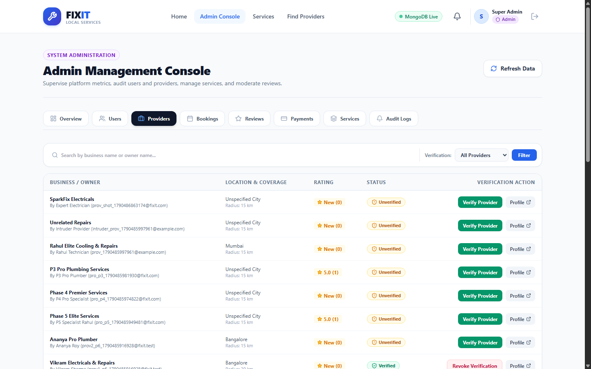 |

| Admin — Service Catalog Manager | Admin — Platform Audit Logs |
| :---: | :---: |
| 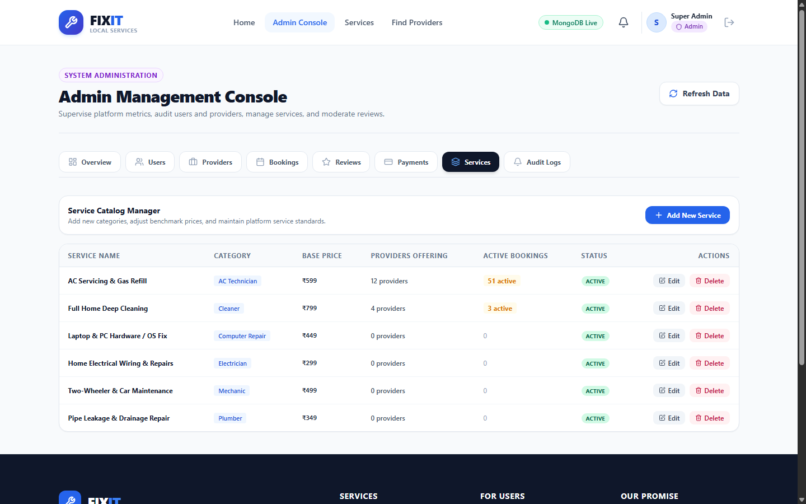 | 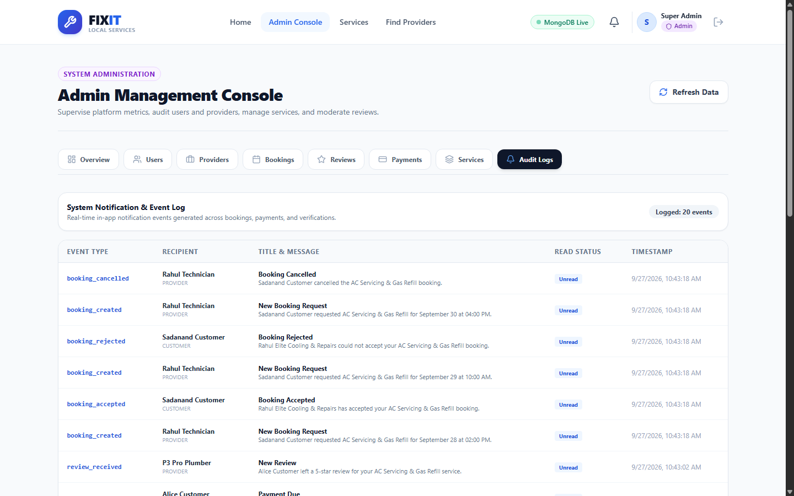 |

---

## Tech Stack

### Frontend
* **React 18**: Single-Page Application with custom hooks and context state management.
* **Vite 6**: High-speed build tooling and optimized production bundling.
* **Tailwind CSS 3**: Modern, responsive utility-first layout styling.
* **React Router v6**: Client-side routing with role-protected route wrappers.
* **Leaflet & React-Leaflet**: Open-source interactive maps without paid API key requirements.
* **Axios**: HTTP client with request/response interceptors for JWT token injection.
* **Lucide React**: Clean vector iconography.

### Backend
* **Node.js 20+**: Non-blocking asynchronous JavaScript runtime.
* **Express 4**: Robust REST API framework with modular controllers and middleware.
* **MongoDB 7+ & Mongoose 8**: Document database with `2dsphere` spatial indexing.
* **JWT & bcryptjs**: Cryptographic token generation and salted hashing.
* **Morgan & CORS**: Production HTTP request logging and origin security.

---

## Automated Testing & Verification

Every phase of the platform has been verified against live MongoDB instances and headless browser sessions:

| Test Suite | File | Verified Capabilities | Assertions | Status |
| :--- | :--- | :--- | :---: | :---: |
| **Phase 6** | `server/utils/test_phase6.js` | Maps, Geolocation, Admin suite, Rating recalc, Service CRUD | **84 / 84** | **100% PASS** |
| **Phase 5** | `server/utils/test_phase5.js` | In-app notifications, event triggers, unread counters, isolation | **77 / 77** | **100% PASS** |
| **Phase 4A** | `server/utils/test_phase4a.js` | Simulated payment lifecycle, state machine transitions, receipts | **57 / 57** | **100% PASS** |
| **Phase 3** | `server/utils/test_phase3.js` | Availability schedule, double-booking prevention, OTP, reviews | **39 / 39** | **100% PASS** |
| **Phase 2** | `server/utils/test_phase2.js` | Authentication, RBAC, booking lifecycle & state transitions | **13 / 13** | **100% PASS** |
| **TOTAL REGRESSION** | — | **Full System Automated Integration Suite** | **270 / 270** | **100% PASS** |
| **Browser QA** | `server/utils/test_phase6_browser_qa.js` | Real Chrome CDP: Map rendering, Admin tabs, Responsive viewports | **21 / 21** | **100% PASS** |
| **Client Build** | `npm run build` | Vite production bundle compilation (0 errors, 4.02s) | **PASS** | **100% PASS** |

---

## API Reference

### Authentication (`/api/auth`)
| Method | Endpoint | Access | Description |
| :--- | :--- | :--- | :--- |
| `POST` | `/api/auth/register` | Public | Register customer, provider, or admin |
| `POST` | `/api/auth/login` | Public | Authenticate credentials and receive JWT |
| `GET` | `/api/auth/me` | Private | Retrieve authenticated user profile |

### Providers & Location (`/api/providers`)
| Method | Endpoint | Access | Description |
| :--- | :--- | :--- | :--- |
| `GET` | `/api/providers` | Public | List approved providers with search and category filters |
| `GET` | `/api/providers/nearby` | Public | Location-aware discovery (`lat`, `lng`, `radius`, `service`) |
| `GET` | `/api/providers/:id` | Public | Get single public provider profile |
| `GET` | `/api/providers/me` | Provider | Retrieve own provider details |
| `PUT` | `/api/providers/me` | Provider | Update business profile, rates, and services |
| `PUT` | `/api/providers/me/location`| Provider | Update GeoJSON coordinates, address, and coverage radius |

### Availability (`/api/availability`)
| Method | Endpoint | Access | Description |
| :--- | :--- | :--- | :--- |
| `GET` | `/api/availability/me` | Provider | Retrieve own weekly schedule |
| `PUT` | `/api/availability/me` | Provider | Set 7-day operating schedule windows |
| `GET` | `/api/availability/provider/:id` | Public | View provider public schedule for booking |

### Bookings (`/api/bookings`)
| Method | Endpoint | Access | Description |
| :--- | :--- | :--- | :--- |
| `POST` | `/api/bookings` | Customer | Create booking (checks schedule & double-booking) |
| `GET` | `/api/bookings/my-bookings` | Customer | View customer booking history |
| `GET` | `/api/bookings/provider` | Provider | View incoming and assigned jobs |
| `GET` | `/api/bookings/:id` | Private | Inspect booking details (masked OTP for provider) |
| `PUT` | `/api/bookings/:id/accept` | Provider | Accept pending booking |
| `PUT` | `/api/bookings/:id/reject` | Provider | Reject pending booking |
| `PUT` | `/api/bookings/:id/confirm` | Customer | Confirm accepted booking (generates OTP) |
| `PUT` | `/api/bookings/:id/verify-otp` | Provider | Verify OTP to start service (`in-progress`) |
| `PUT` | `/api/bookings/:id/complete` | Provider | Complete service |
| `PUT` | `/api/bookings/:id/cancel` | Private | Cancel booking before service commences |

### Reviews (`/api/reviews`)
| Method | Endpoint | Access | Description |
| :--- | :--- | :--- | :--- |
| `POST` | `/api/reviews` | Customer | Review completed booking (updates provider rating) |
| `GET` | `/api/reviews/provider/:id` | Public | Get public reviews for a provider |

### Simulated Payments (`/api/payments`)
| Method | Endpoint | Access | Description |
| :--- | :--- | :--- | :--- |
| `POST` | `/api/payments/create` | Customer | Initialize demo payment for completed booking |
| `POST` | `/api/payments/:id/process` | Customer | Simulate processing (success or test failure) |
| `POST` | `/api/payments/:id/cancel` | Customer | Cancel pending payment attempt |
| `GET` | `/api/payments/booking/:id` | Private | Retrieve payment record by booking |
| `GET` | `/api/payments/my-payments` | Customer | View customer payment receipts |

### Notifications (`/api/notifications`)
| Method | Endpoint | Access | Description |
| :--- | :--- | :--- | :--- |
| `GET` | `/api/notifications` | Private | List user notifications (paginated) |
| `GET` | `/api/notifications/unread-count`| Private | Get live unread notification count |
| `PUT` | `/api/notifications/:id/read` | Private | Mark specific notification as read |
| `PUT` | `/api/notifications/read-all` | Private | Mark all own notifications as read |

### Administration (`/api/admin`)
| Method | Endpoint | Access | Description |
| :--- | :--- | :--- | :--- |
| `GET` | `/api/admin/dashboard` | Admin | High-level platform statistics and metrics |
| `GET` | `/api/admin/users` | Admin | List, search, and filter all platform users |
| `GET` | `/api/admin/users/:id` | Admin | Inspect individual user and linked provider profile |
| `GET` | `/api/admin/providers` | Admin | List providers with verification status filter |
| `PUT` | `/api/admin/providers/:id/verify` | Admin | Toggle provider verified badge (notifies provider) |
| `GET` | `/api/admin/bookings` | Admin | Platform-wide bookings audit |
| `GET` | `/api/admin/bookings/:id` | Admin | Detailed booking inspection modal |
| `GET` | `/api/admin/reviews` | Admin | Audit all customer reviews |
| `DELETE` | `/api/admin/reviews/:id` | Admin | Delete review with automatic provider rating recalculation |
| `GET` | `/api/admin/payments` | Admin | Platform-wide payment transactions audit |
| `GET` | `/api/admin/services` | Admin | Catalog services manager list |
| `POST` | `/api/admin/services` | Admin | Create new service category |
| `PUT` | `/api/admin/services/:id` | Admin | Update service details or pricing |
| `DELETE` | `/api/admin/services/:id` | Admin | Delete service (strictly blocked if active bookings exist) |
| `GET` | `/api/admin/notifications` | Admin | System-wide audit event logs |

---

## Local Development Setup

### Prerequisites
* **Node.js** (v18.0 or higher recommended)
* **MongoDB** (Local instance running on `127.0.0.1:27017` or MongoDB Atlas URI)
* **npm** or **yarn**

### 1. Clone & Install Dependencies
```bash
git clone https://github.com/your-username/fixit.git
cd fixit

# Install server dependencies
cd server
npm install

# Install client dependencies
cd ../client
npm install
cd ..
```

### 2. Configure Environment Variables
Create environment files from the provided templates:

**Server (`server/.env`):**
```env
PORT=5000
NODE_ENV=development
MONGODB_URI=mongodb://127.0.0.1:27017/fixit
JWT_SECRET=your_super_secret_jwt_key_for_development
JWT_EXPIRE=30d
CLIENT_URL=http://localhost:5173
```

**Client (`client/.env`):**
```env
VITE_API_BASE_URL=http://localhost:5000/api
VITE_APP_NAME=FIXIT
```

### 3. Seed Initial Service Catalog
Populate default categories (Electrician, Plumber, AC Technician, Mechanic, Cleaner, Computer Repair):
```bash
cd server
npm run seed
```

### 4. Start the Application
Open two terminal windows:

**Terminal 1 (Backend API):**
```bash
cd server
npm run dev
# Server starts on http://localhost:5000
```

**Terminal 2 (Frontend Client):**
```bash
cd client
npm run dev
# Vite client starts on http://localhost:5173
```

---

## Docker Deployment

To run the complete platform (MongoDB, Backend, and Nginx-served Frontend) in isolated containers:

```bash
# Build and start all 3 services in the background
docker-compose up -d --build

# View container logs
docker-compose logs -f

# Stop containers
docker-compose down
```

* **Frontend**: Accessible at `http://localhost:5173`
* **Backend API**: Accessible at `http://localhost:5000`
* **MongoDB**: Accessible at `localhost:27017`

---

## Production Deployment Guide

### Primary Architecture

```
Frontend:  React + Vite  -->  Vercel
Backend:   Node + Express -->  Render
Database:  MongoDB Atlas -->  Cloud Cluster
```

### Step 1: Deploy MongoDB Atlas Database
1. Create a free cluster on [MongoDB Atlas](https://www.mongodb.com/cloud/atlas).
2. Create a database user with read/write credentials.
3. In **Network Access**, add `0.0.0.0/0` (allow access from anywhere) to allow Render backend connectivity.
4. Copy the connection string:
   `mongodb+srv://<username>:<password>@cluster0.abcde.mongodb.net/fixit?retryWrites=true&w=majority`

### Step 2: Deploy Backend to Render
1. Create a new **Web Service** on [Render](https://render.com) connected to your repository.
2. Configure settings:
   * **Root Directory**: `server`
   * **Environment**: `Node`
   * **Build Command**: `npm install`
   * **Start Command**: `npm start`
3. Add Environment Variables:
   * `NODE_ENV`: `production`
   * `PORT`: `5000`
   * `MONGODB_URI`: `<Your MongoDB Atlas Connection String>`
   * `JWT_SECRET`: `<Generate a random 32+ character key>`
   * `JWT_EXPIRE`: `30d`
   * `CLIENT_URL`: `https://your-fixit-app.vercel.app`
4. Deploy the service and copy the deployed backend URL (e.g. `https://fixit-api.onrender.com`).

### Step 3: Deploy Frontend to Vercel
1. Import your repository into [Vercel](https://vercel.com).
2. Configure project settings:
   * **Framework Preset**: `Vite`
   * **Root Directory**: `client`
   * **Build Command**: `npm run build`
   * **Output Directory**: `dist`
3. Add Environment Variables:
   * `VITE_API_BASE_URL`: `https://fixit-api.onrender.com/api`
4. Deploy the project. The included `client/vercel.json` guarantees direct URL access and React Router SPA client-side routing.
5. In your Render dashboard, update `CLIENT_URL` to match your finalized Vercel domain (`https://your-fixit-app.vercel.app`).
